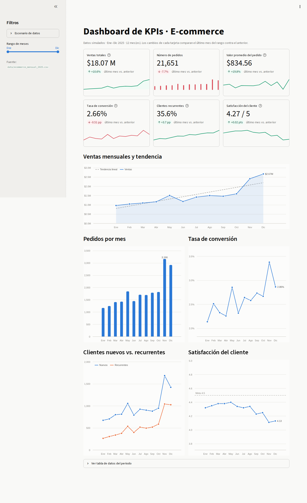

# Dashboard de KPIs · E-commerce

Dashboard interactivo con los indicadores clave (KPIs) de una tienda en línea
durante 12 meses. Está construido con **Streamlit** (la página, los filtros y las
tarjetas) y **Bokeh** (las gráficas interactivas), y se despliega en un
contenedor de **Docker**.

> Los datos son **simulados**: no pertenecen a ninguna empresa real. Se generan
> con reglas de negocio documentadas y una semilla fija, así que siempre se
> obtienen los mismos números (ver [`data/README.md`](data/README.md)).



---

## KPIs incluidos

| KPI | Cómo se calcula | Visualización |
|---|---|---|
| Ventas totales y tendencia | Suma de `ventas_mxn` + recta de mínimos cuadrados | Tarjeta + gráfica de línea con área |
| Número de pedidos | Suma de `pedidos` | Tarjeta + gráfica de barras |
| Valor promedio del pedido (AOV) | `ventas / pedidos` | Tarjeta |
| Tasa de conversión | `pedidos / visitas` | Tarjeta + gráfica de línea |
| Clientes recurrentes vs. nuevos | `recurrentes / (nuevos + recurrentes)` | Tarjeta + gráfica de tendencia (2 series) |
| Satisfacción del cliente | Promedio de calificación ponderado por reseñas | Tarjeta + gráfica de línea con meta |

Cada tarjeta muestra el total del periodo, el cambio del **último mes contra el
anterior** y una mini-gráfica de la evolución. Las gráficas de Bokeh muestran un
*tooltip* con el detalle al pasar el mouse.

## Estructura del repositorio

```
Dashboard-KPIS/
├── app/                      # Código del dashboard (lo que se despliega)
│   ├── dashboard.py          #   Punto de entrada de Streamlit
│   ├── datos.py              #   Simulación y carga de datos
│   ├── kpis.py               #   Cálculo de KPIs (funciones puras)
│   ├── graficas.py           #   Gráficas con Bokeh
│   └── tema.py               #   Colores y constantes visuales
├── data/                     # Datos generados
│   ├── ecommerce_mensual_2025.csv
│   └── README.md             #   Diccionario de datos
├── deploy/                   # Especificaciones de despliegue
│   ├── Dockerfile
│   ├── docker-compose.yml
│   └── README.md
├── docs/
│   ├── INSTRUCTIVO.md        # Guía para entender y exponer el proyecto
│   └── img/dashboard.png
├── scripts/
│   └── generar_datos.py      # Regenera el CSV de data/
├── tests/                    # Pruebas automáticas (pytest)
├── .streamlit/config.toml    # Tema y configuración de Streamlit
├── requirements.txt          # Dependencias de ejecución
├── requirements-dev.txt      # + dependencias de pruebas
├── pyproject.toml            # Configuración de pytest
├── AUTOR.md
├── .gitignore
└── .dockerignore
```

## Inicio rápido

### Opción A: Docker (recomendada)

Requisitos: Docker con el plugin de Compose.

```bash
docker compose -f deploy/docker-compose.yml up --build -d
```

Abrir <http://localhost:8501>. Para detenerlo:

```bash
docker compose -f deploy/docker-compose.yml down
```

Más detalles (puertos, healthcheck, comandos sin Compose) en
[`deploy/README.md`](deploy/README.md).

### Opción B: Entorno local

Requisitos: Python 3.12.

```bash
python3 -m venv .venv
source .venv/bin/activate          # En Windows: .venv\Scripts\activate
pip install -r requirements.txt
streamlit run app/dashboard.py
```

### Regenerar los datos

```bash
python scripts/generar_datos.py              # semilla 42 (la que se versiona)
python scripts/generar_datos.py --semilla 7  # otro escenario
```

También se puede explorar otro escenario desde el propio dashboard
(barra lateral → *Escenario de datos*), sin modificar el CSV.

## Pruebas

```bash
pip install -r requirements-dev.txt
pytest
```

Las pruebas verifican que la simulación sea reproducible y que las fórmulas de
los KPIs den el resultado calculado a mano.

## Tecnologías

| Herramienta | Versión | Uso |
|---|---|---|
| Python | 3.12 | Lenguaje |
| Streamlit | 1.67.0 | Interfaz web, filtros y tarjetas de métricas |
| Bokeh | 3.10.0 | Gráficas interactivas |
| streamlit-bokeh | 3.10.1 | Componente oficial para incrustar Bokeh en Streamlit |
| pandas / NumPy | 3.1.1 / 2.5.4 | Manejo de datos y simulación |
| Docker | — | Empaquetado y despliegue |

## Documentación

- [`docs/INSTRUCTIVO.md`](docs/INSTRUCTIVO.md): cómo funciona cada pieza y un guion para exponerlo.
- [`data/README.md`](data/README.md): diccionario de datos y reglas de la simulación.
- [`deploy/README.md`](deploy/README.md): especificaciones de despliegue.

## Autor

Ver [`AUTOR.md`](AUTOR.md).

## Licencia

Pendiente de definir antes de publicar el repositorio.
